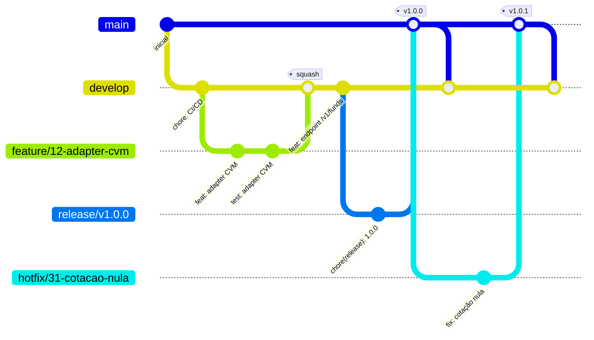

# Como contribuir

Este documento é a referência prática do dia a dia: como nomear uma branch, como
escrever um commit, como abrir um PR, como cortar uma release e como corrigir
produção às pressas. A decisão por trás destas regras está no
[ADR 0014](adr/0014-fluxo-de-branches-e-cicd.md).

## Modelo de branches



### O que cada branch é

| Branch | Papel | Sai de | Volta para | Merge |
| --- | --- | --- | --- | --- |
| `main` | Produção. Cada merge gera uma tag `vX.Y.Z`. | — | — | merge commit |
| `develop` | Integração. Deploy automático em staging. | `main` | — | squash |
| `feature/<issue>-<slug>` | Funcionalidade nova | `develop` | `develop` | squash |
| `fix/<issue>-<slug>` | Correção não urgente | `develop` | `develop` | squash |
| `hotfix/<issue>-<slug>` | Correção urgente em produção | `main` | `main` **e** `develop` | merge commit |
| `release/vX.Y.Z` | Congelamento para produção; só aceita `fix/*` | `develop` | `main` **e** `develop` | merge commit |
| `chore/`, `docs/`, `refactor/`, `test/` | Manutenção | `develop` | `develop` | squash |

`main` só aceita PR de `release/*` e `hotfix/*`. Um PR de `feature/*` para `main`
é reprovado pelo check `pr-meta`, com a explicação no resumo da execução.

### Nome da branch

```
<tipo>/<issue>-<slug>
```

- `<tipo>`: `feature`, `fix`, `hotfix`, `chore`, `docs`, `refactor` ou `test`
- `<issue>`: número da issue, sem `#`
- `<slug>`: kebab-case, minúsculas, números e hífen, até 50 caracteres

Exemplos válidos:

```
feature/12-adapter-cvm
fix/47-cotacao-nula-em-feriado
chore/58-bump-node-22
release/v1.2.0
```

O check `pr-meta` valida o nome. Branches de automação (`renovate/*`,
`release-please--*`) são isentas.

Branches são apagadas automaticamente depois do merge.

## Convenção de commits

[Conventional Commits](https://www.conventionalcommits.org/pt-br/v1.0.0/), porque
é daí que o release-please tira a versão e o CHANGELOG.

```
<tipo>(<escopo opcional>): <descrição>

<corpo opcional>

<rodapé opcional>
```

Tipos: `feat`, `fix`, `docs`, `style`, `refactor`, `perf`, `test`, `build`, `ci`,
`chore`, `revert`.

Efeito na versão:

| Commit | Versão |
| --- | --- |
| `fix:` | patch (1.2.3 → 1.2.4) |
| `feat:` | minor (1.2.3 → 1.3.0) |
| `feat!:` ou rodapé `BREAKING CHANGE:` | major (1.2.3 → 2.0.0) |
| `chore:`, `ci:`, `test:`, `style:` | nenhuma |

Referencie a issue na descrição:

```
feat(market-data): adiciona adapter CVM (#12)
```

O **título do PR** também precisa seguir a convenção: como `develop` usa squash
com a mensagem derivada do título, é o título que vira o commit no histórico.

## Como abrir um PR

```bash
# 1. Issue. Se não existir, crie.
gh issue create --template feature.yml

# 2. Base atualizada
git fetch origin
git switch -c feature/12-adapter-cvm origin/develop

# 3. Trabalhe, commitando pequeno
git commit -m "feat(market-data): adiciona adapter CVM (#12)"

# 4. Antes do push, rode o que o CI vai rodar
make lint test

# 5. Push e PR
git push -u origin feature/12-adapter-cvm
gh pr create --base develop --fill

# 6. Acompanhe os checks
gh pr checks --watch
```

O template do PR é preenchido automaticamente; complete o contexto, o `Closes #N`
e o checklist. Se um check falhar, corrija na mesma branch. Nunca desative teste
ou check para o CI passar.

### Labels que mudam o comportamento do CI

| Label | Efeito |
| --- | --- |
| `breaking-change` | O check `contract` passa a aceitar quebra em `/v1`. Exige nota de migração em `docs/`. |
| `no-docs` | O check `docs-check` passa sem alteração em `docs/`. A justificativa vai no corpo do PR. |

Aplicar uma dessas labels é uma decisão consciente, registrada no PR. Não são
atalho para o CI ficar verde.

## Como fazer uma release

Resumo; o passo a passo está em [docs/runbooks/release.md](runbooks/release.md).

1. `develop` verde e com o que deve ir para produção.
2. Corte `release/vX.Y.Z` a partir de `develop`. Só `fix/*` entra depois disso.
3. Abra o PR de `release/vX.Y.Z` para `main`.
4. Merge (merge commit). O release-please abre o PR de release com CHANGELOG e versão.
5. Merge do PR de release em `main`: nasce a tag `vX.Y.Z` e o GitHub Release.
6. A tag dispara o CD de produção, que **promove as imagens de staging** sem reconstruir.
7. Aprove o deploy no environment `production`.
8. Back-merge de `main` para `develop` — o PR é aberto automaticamente.

## Como fazer um hotfix

Resumo; o passo a passo está em [docs/runbooks/hotfix.md](runbooks/hotfix.md).

1. Branch a partir de **`main`**, não de `develop`: `hotfix/<issue>-<slug>`.
2. Correção mínima, com teste que reproduz o bug.
3. PR para `main`.
4. Merge: o release-please gera a versão patch e a tag.
5. O CD de produção roda; aprove o deploy.
6. O PR de back-merge para `develop` é aberto automaticamente. **Mergeie.** Sem
   isso, a próxima release desfaz a correção.

## Documentação e ADR

- Mudou código em `apps/`, `services/` ou `packages/`? Então `docs/` muda também,
  ou o PR leva a label `no-docs` com justificativa. O check `docs-check` cobra isso.
- Decisão de arquitetura nova vira ADR em [docs/adr](adr/), formato
  [MADR](https://adr.github.io/madr/), numerado em sequência.
- Variável de ambiente nova entra no `.env.example` no mesmo PR.

## Ambiente local

Nada aqui exige Node, pnpm ou psql instalados. Só Docker e make.

```bash
make help        # lista os alvos
make up          # sobe o ambiente
make lint test   # o que o CI vai rodar
make check       # actionlint, links e gitleaks
make down        # derruba e limpa
```
